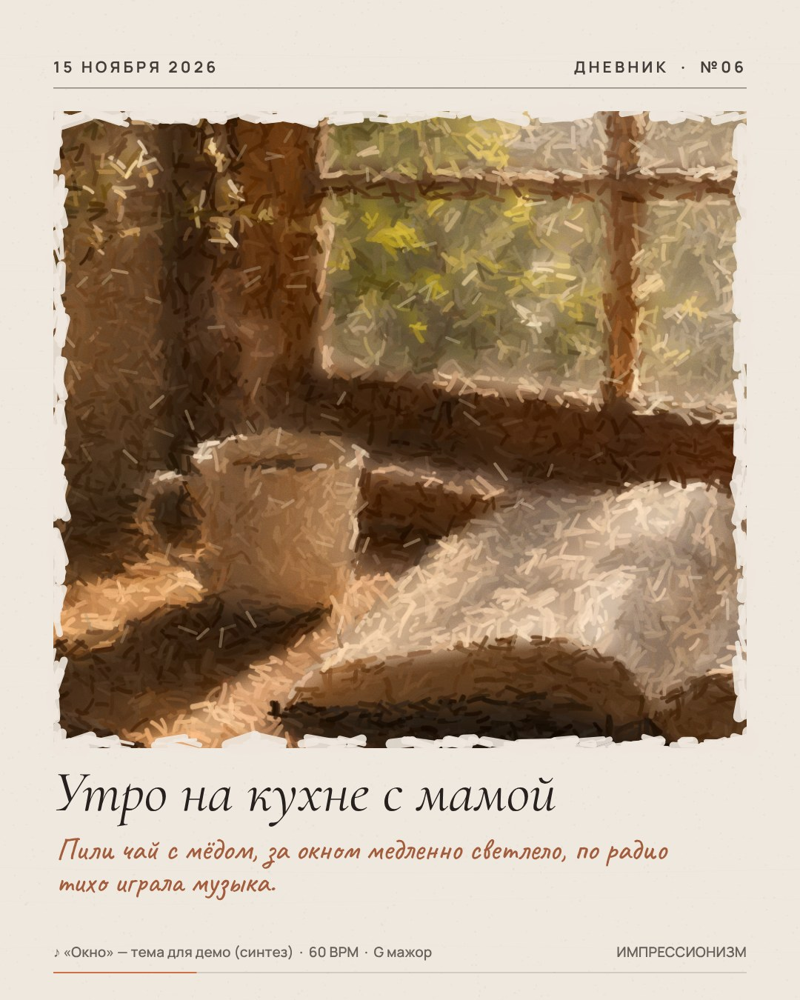
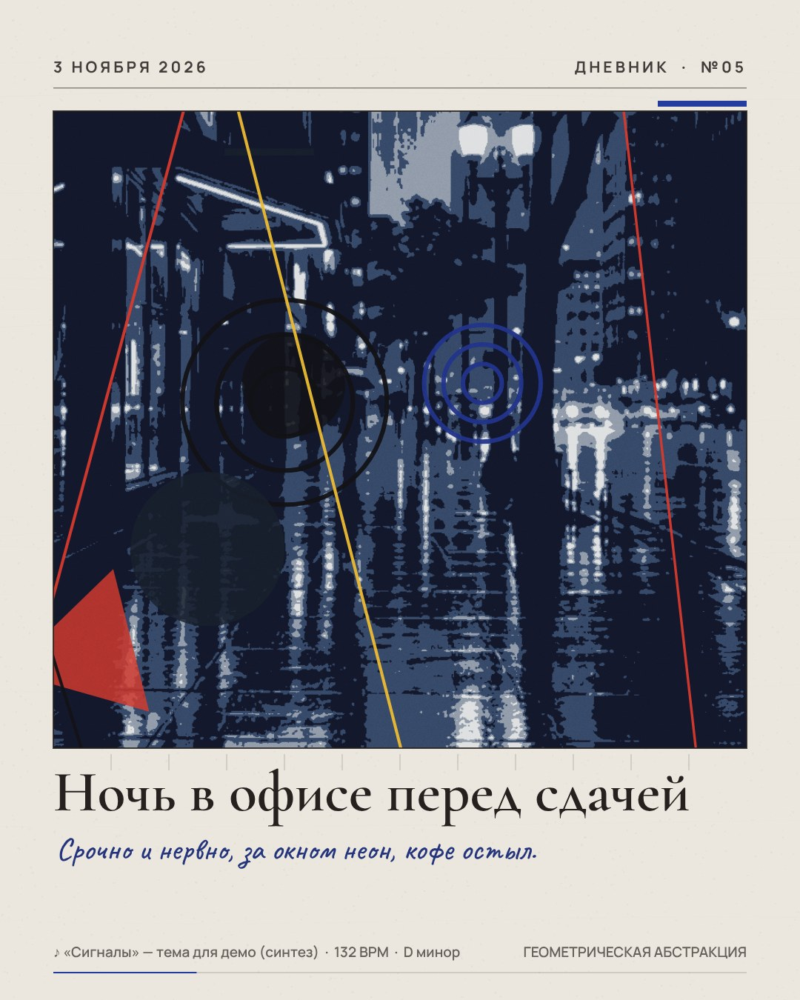
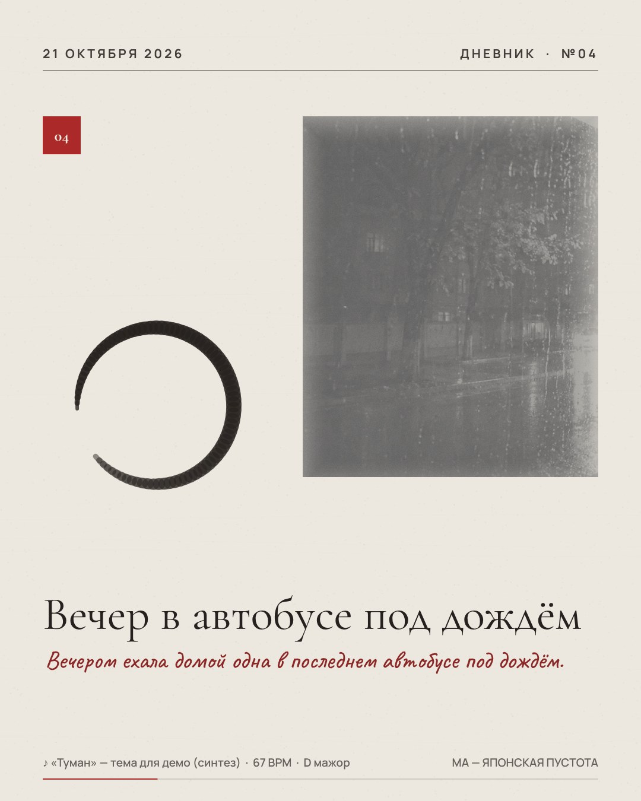
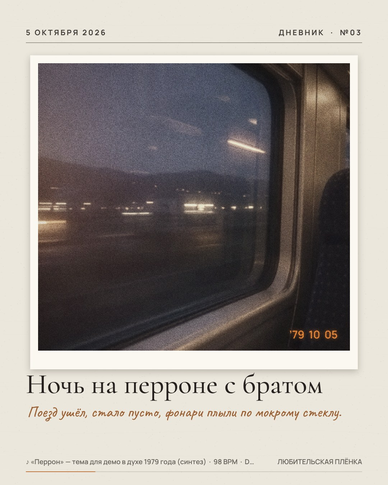
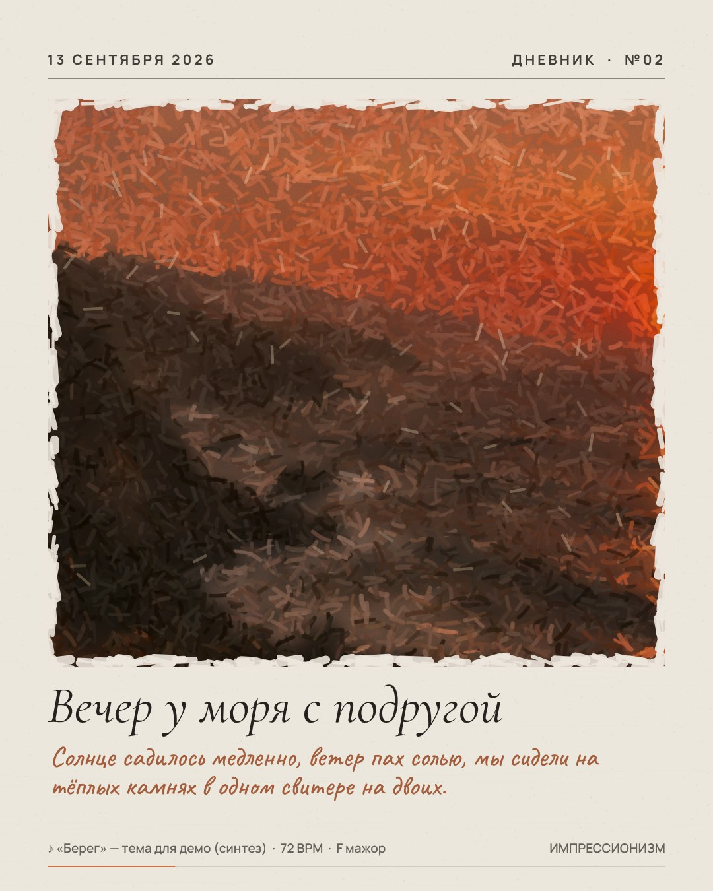
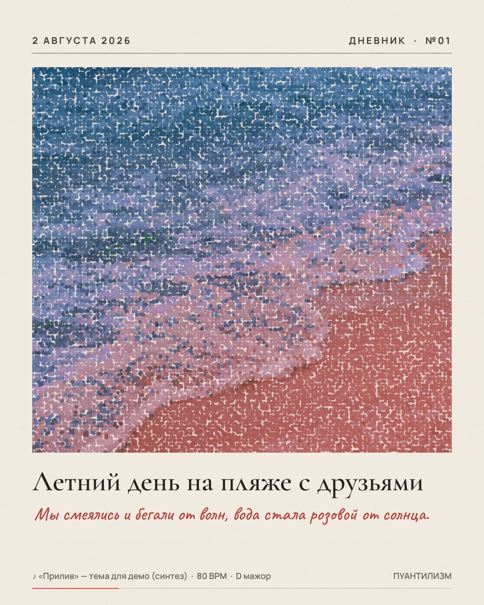
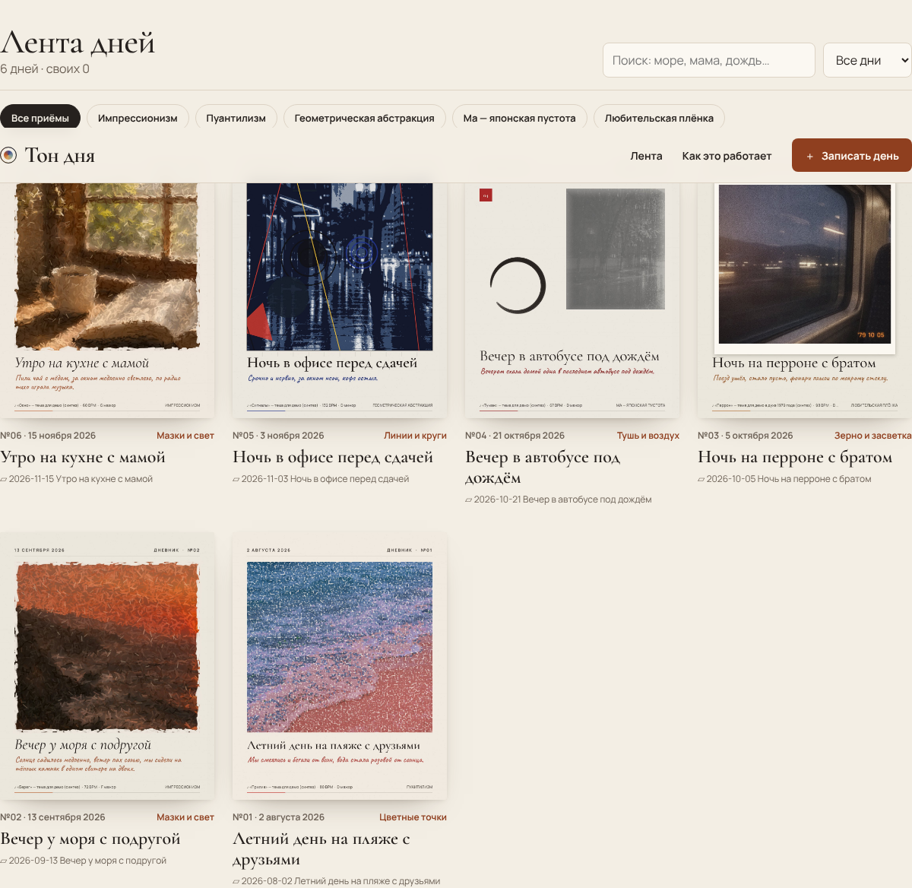

# Примеры дней

Кадры страниц шести вымышленных дней, собранных прототипом. Названия папок придуманы системой по тексту записи.

| Страница | Папка дня | Приём |
|---|---|---|
|  | «2026-11-15 Утро на кухне с мамой» | Мазки и свет |
|  | «2026-11-03 Ночь в офисе перед сдачей» | Линии и круги |
|  | «2026-10-21 Вечер в автобусе под дождём» | Тушь и воздух |
|  | «2026-10-05 Ночь на перроне с братом» | Зерно и засветка |
|  | «2026-09-13 Вечер у моря с подругой» | Мазки и свет |
|  | «2026-08-02 Летний день на пляже с друзьями» | Цветные точки |

